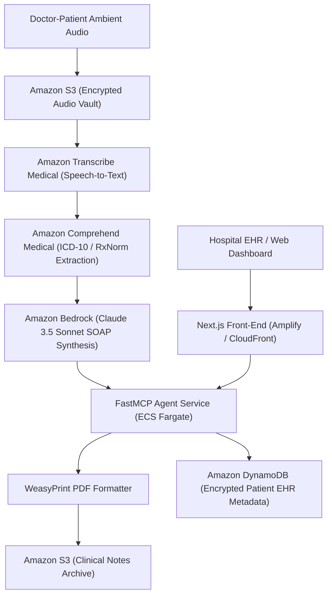

# MediScribe AI Platform — Clinical Ambient Intelligence & Medical EHR RAG

[](#aws-cloud-architecture)
[](#system-architecture)
[](#branch-architecture)
[](LICENSE)

> Autonomous clinical transcription, EHR entity extraction, and structured SOAP note synthesis designed for high-throughput healthcare environments.

---

## 1. Executive Brief
Physicians spend upwards of 2 hours per shift charting EHR notes. **MediScribe AI Platform** captures ambient doctor-patient dialogue, transcribes clinical terminology via Amazon Transcribe Medical, extracts ICD-10/SNOMED entities, and generates standardized SOAP notes ready for export.

* **Preservation**: Original codebase preserved on [`Ex`](https://github.com/prak05/MediScribe-AI-Platform/tree/Ex).
* **Architecture**: AWS Cloud Native with FastMCP agentic tools and WeasyPrint clinical note generation.

---

## 2. AWS Cloud Architecture



---

## 3. Key Enhancements
1. **FastMCP Server**: Standardized Model Context Protocol server exposing clinical tools (`retrieve_guideline`, `validate_dosage`, `format_soap_note`).
2. **WeasyPrint Clean Pipeline**: Eliminated fragile headless browser dependencies (Playwright) in favor of high-performance WeasyPrint CSS-to-PDF formatting.
3. **KMS & PHI Protection**: Zero logging of patient identifiers; dynamic pseudonymization of names and dates before LLM ingestion.

---

## 4. Run & Deployment Runbook

```bash
# Run locally with Docker Compose
docker compose up -d

# Deploy to AWS ECS Fargate
cd infra/aws && terraform apply
```

---

## 5. Branch Architecture
* [`main`](https://github.com/prak05/MediScribe-AI-Platform/tree/main): Modernized AWS Mantle architecture with FastMCP and WeasyPrint.
* [`Ex`](https://github.com/prak05/MediScribe-AI-Platform/tree/Ex): Preserved baseline snapshot.
