<div align="center">

# 🩺 MediScribe AI Platform
### Clinical Ambient Intelligence & Medical EHR Synthesis Engine

<p align="center">
  
</p>

<p align="center">
  
  
  
  
</p>


</div>

---

### 🎙️ Ambient Consultation Telemetry

```yaml
Audio Stream   : 16kHz PCM FLAC (Encrypted via AWS KMS)
Speech Engine  : Amazon Transcribe Medical (Primary Care Dictation)
Latency        : Real-time chunking (2.4s sliding window)
Entities Found : [ICD-10-CM: I10 Essential Hypertension], [RxNorm: Lisinopril 10mg]
Output Format  : Verified Clinical SOAP Note (WeasyPrint PDF + JSON EHR)
```

---

## 🏛️ Clinical Bento Grid

<table width="100%">
  <tr>
    <td width="50%" valign="top">
      <h3>🩺 Ambient Audio to SOAP Note</h3>
      <p>Direct speech-to-clinical text conversion isolating doctor and patient speaker channels, extracting symptoms, vitals, and producing structured SOAP documentation.</p>
      <b>Features:</b> Subjective, Objective, Assessment, Plan separation
    </td>
    <td width="50%" valign="top">
      <h3>🛡️ FastMCP Medical Protocol</h3>
      <p>Custom <b>Model Context Protocol (MCP)</b> microservice enabling LLM agents to safely query drug-drug interactions and dosage calculators without leaving context.</p>
      <b>Features:</b> Standardized tool calls • Deterministic outputs
    </td>
  </tr>
  <tr>
    <td width="50%" valign="top">
      <h3>📑 Clean WeasyPrint PDF Pipeline</h3>
      <p>High-speed, institutional PDF rendering using CSS Paged Media standards. Completely eliminated fragile headless browser dependencies (Playwright).</p>
      <b>Features:</b> Millisecond note compilation • Custom clinic branding
    </td>
    <td width="50%" valign="top">
      <h3>🔒 KMS Envelope Encryption & PHI Vault</h3>
      <p>Patient identifiers are dynamically pseudonymized before any LLM inference occurs. Data at rest is encrypted using customer-managed AWS KMS keys.</p>
      <b>Features:</b> Zero data retention mode • Audit logs in DynamoDB
    </td>
  </tr>
</table>

---

## 🔄 Clinical Streaming Flow

```mermaid
flowchart LR
    Mic["Doctor-Patient Dialogue"] --> S3Audio["Encrypted S3 Audio"]
    S3Audio --> Transcribe["Amazon Transcribe Medical"]
    Transcribe --> Comprehend["Comprehend Medical (RxNorm/ICD-10)"]
    Comprehend --> Bedrock["Bedrock Claude 3.5 (SOAP Synthesis)"]
    Bedrock --> FastMCP["FastMCP Clinical Agent"]
    FastMCP --> WeasyPrint["WeasyPrint PDF Generator"]
    WeasyPrint --> S3Notes["S3 Patient Records"]
```



---

## ⚡ Quickstart

```bash
# Clone repository
git clone https://github.com/prak05/MediScribe-AI-Platform.git
cd MediScribe-AI-Platform

# Start services locally
docker compose up -d
open http://localhost:3000
```

---

<div align="center">
<sub>Preserved Baseline: <a href="https://github.com/prak05/MediScribe-AI-Platform/tree/Ex">branch Ex</a> • Engineered for Scalable Production Clouds</sub>
</div>
